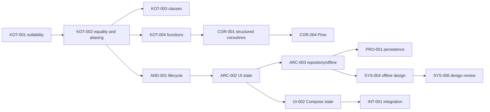

# Conceptual prerequisite map

The 48-day *study order* is in [STUDY-SCHEDULE-48-DAYS](STUDY-SCHEDULE-48-DAYS.md) and the manifest `sequence_previous` field. The `prerequisites` field below means concepts a learner should already understand, not simply yesterday’s ID. An empty set means the topic can be studied independently at the planned depth. Future lesson authors must recheck these edges against actual examples.

The graph shows representative cross-domain edges; the table is the complete registry. For example, `UI-003` requires both Compose state and Flow, whereas `INT-004` behavioral storytelling has no technical prerequisite.

| Lesson | Conceptual prerequisites | Previous in study sequence |
|---|---|---|
| KOT-001 | none | none |
| KOT-002 | KOT-001 | KOT-001 |
| KOT-003 | KOT-002 | KOT-002 |
| KOT-004 | KOT-002 | KOT-003 |
| KOT-005 | KOT-003, KOT-004 | KOT-004 |
| KOT-006 | KOT-001, KOT-002, KOT-005 | KOT-005 |
| COR-001 | KOT-004 | KOT-006 |
| COR-002 | COR-001 | COR-001 |
| COR-003 | COR-002 | COR-002 |
| COR-004 | COR-001 | COR-003 |
| COR-005 | COR-003, COR-004 | COR-004 |
| COR-006 | COR-003, COR-004 | COR-005 |
| AND-001 | KOT-002 | COR-006 |
| AND-002 | AND-001 | AND-001 |
| AND-003 | AND-001 | AND-002 |
| AND-004 | AND-001 | AND-003 |
| AND-005 | AND-003, AND-004 | AND-004 |
| AND-006 | AND-001, AND-004 | AND-005 |
| ARC-001 | KOT-003 | AND-006 |
| ARC-002 | AND-001 | ARC-001 |
| ARC-003 | ARC-002 | ARC-002 |
| ARC-004 | ARC-003 | ARC-003 |
| ARC-005 | ARC-001, ARC-003 | ARC-004 |
| ARC-006 | ARC-002, ARC-003 | ARC-005 |
| UI-001 | AND-001 | ARC-006 |
| UI-002 | ARC-002 | UI-001 |
| UI-003 | UI-002, COR-004 | UI-002 |
| UI-004 | AND-002, UI-002 | UI-003 |
| UI-005 | UI-001, UI-002 | UI-004 |
| UI-006 | UI-002, UI-005 | UI-005 |
| PRO-001 | ARC-003 | UI-006 |
| PRO-002 | COR-003, ARC-003 | PRO-001 |
| PRO-003 | AND-003 | PRO-002 |
| PRO-004 | KOT-006 | PRO-003 |
| PRO-005 | AND-004 | PRO-004 |
| PRO-006 | PRO-002, PRO-004 | PRO-005 |
| SYS-001 | KOT-002 | PRO-006 |
| SYS-002 | SYS-001 | SYS-001 |
| SYS-003 | ARC-003, PRO-002, PRO-003 | SYS-002 |
| SYS-004 | ARC-003, PRO-001 | SYS-003 |
| SYS-005 | COR-004, PRO-002, SYS-004 | SYS-004 |
| SYS-006 | SYS-001, SYS-004 | SYS-005 |
| INT-001 | ARC-005, UI-006, PRO-006 | SYS-006 |
| INT-002 | AND-004, PRO-005 | INT-001 |
| INT-003 | PRO-003, PRO-005 | INT-002 |
| INT-004 | none | INT-003 |
| INT-005 | KOT-001 | INT-004 |
| INT-006 | INT-001, INT-002, INT-003, INT-004, INT-005 | INT-005 |

Extended topic prerequisites are recorded in [CONTENT-MANIFEST](CONTENT-MANIFEST.json). A learner may jump ahead if they can already demonstrate the prerequisite reasoning; the calendar is guidance, not a hard gate.
