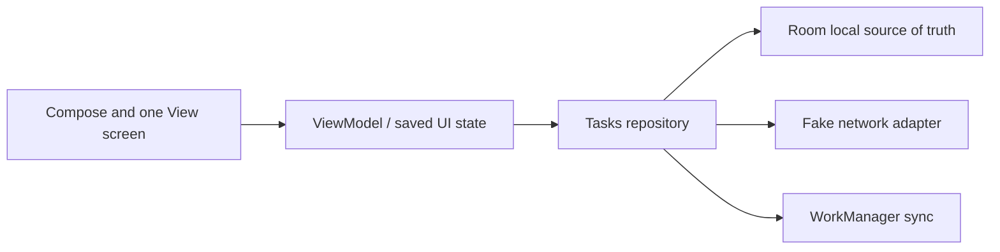

# Offline-first profile/tasks capstone — architecture contract

**Status: planned architecture, Android code not created or built.** No Android SDK/AGP/Compose dependency set was verified in this batch, so the intended `offline-first-android-capstone/` project directory has not been created. The independently runnable [Kotlin/JVM boundary lab](kotlin-jvm-labs/README.md) supplies one small milestone-1 validation technique; it is not misrepresented as the capstone app.

## Intended boundaries

The local database is the intended source of truth for displayed tasks; a fake remote interface supplies deterministic failures and conflict cases. ViewModel owns presentation state, not the database or user session singleton. The Android OS controls lifecycle/scheduling; the fake backend controls server acceptance and idempotency. This is a **design proposal**, not a verified implementation. Compare direct network-driven UI (smaller first demo, poor offline behavior) with local-first repository (more migration/sync complexity, clearer offline state). Choose only after workload and consistency requirements are specified. [Android architecture recommendations](https://developer.android.com/topic/architecture/recommendations) are guidance, checked 2026-10-10.

## Milestone-to-lesson map and acceptance evidence

| Milestone | Lessons | Intended deliverable / test |
|---|---|---|
| 1 domain models and validation | KOT-001..006 | Pure JVM models and validation tests; Day 1 lab is a separate preparatory example. |
| 2 concurrency and state | COR-001..006 | Controlled scheduler tests for stale response, cancellation, loading and error. |
| 3 lifecycle/navigation | AND-001..006, UI-004 | ViewModel/SavedStateHandle restoration and recreation tests. |
| 4 data/DI/offline | ARC-001..006, PRO-001 | Room migration, repository and sync consistency tests. |
| 5 UI and accessibility | UI-001..006 | Compose + one View screen, RTL/font scale/semantics checks. |
| 6 networking/recovery | PRO-002..003 | Fake timeout, retry, session, WorkManager failure tests. |
| 7 release evidence | PRO-004..006 | R8 variant, mapping/retrace, profiling baseline and release notes. |
| 8 design/incident review | SYS-001..006, INT-001..006 | Diagram, ADR, incident exercise, explanation, and test summary. |

## ADR 001 — Defer Android scaffold until toolchain verification

**Decision:** Keep the first batch's runnable proof in a standalone JVM project. **Reason:** Kotlin/Gradle/JDK were verified together, but no Android SDK and compatible AGP/KSP/Compose/AndroidX set was established. **Alternative:** Generate Android Gradle files now and mark them unrun; rejected because an incomplete scaffold could look like a working app. **Revisit when:** SDK path and pinned compatible versions are verified from official sources and an actual build can be attempted.

**Test plan:** Domain tests first; then deterministic coroutine tests, Room migrations, process recreation, UI semantics, fake network failures, and release R8 checks as milestones land. **Change history:** 2026-10-10 architecture-only map and ADR created. No implementation milestone is marked complete.
